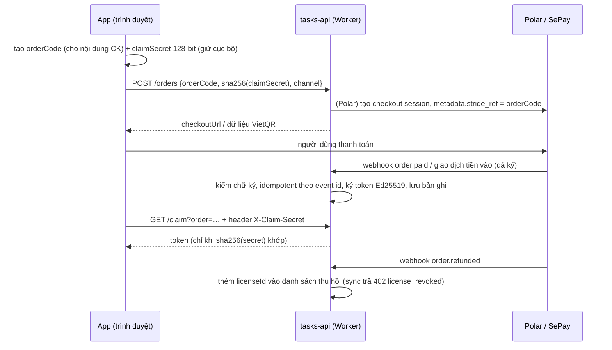

# Thanh toán & Merchant of Record (MoR)

> **Thuộc**: 01-business · **Trạng thái**: Draft v1 — *quyết định đề xuất, xem ADR-0006* · **Cập nhật**: 2026-10-30
> **Mục đích**: chọn cổng thu tiền **nhận được tiền về Việt Nam** và **tự lo thuế VAT/GST toàn cầu** cho người bán cá nhân.

## 1. Vì sao cần Merchant of Record

Bán phần mềm số ra quốc tế phát sinh nghĩa vụ thuế tiêu dùng (VAT EU/UK, GST Úc/Ấn, sales tax Mỹ…) tại nước **người mua**.
Một MoR **đứng tên người bán hợp pháp**, thu thuế và nộp thay, xử lý hoàn tiền/chargeback, rồi chi trả phần còn lại cho bạn.
Với người bán cá nhân ở Việt Nam (Stripe không mở trực tiếp cho Việt Nam), MoR gần như là lựa chọn duy nhất hợp lý.

## 2. Phát hiện quan trọng: LemonSqueezy có rủi ro

- LemonSqueezy (thuộc Stripe) công bố hướng chuyển sang **Stripe Managed Payments**; dịch vụ này hiện hỗ trợ người bán ở **khoảng 35+ quốc gia**, và với quốc gia chưa hỗ trợ thì gợi ý lập công ty qua Stripe Atlas.
- Việt Nam **không** nằm trong nhóm được nêu → luồng `VITE_LEMONSQUEEZY_CHECKOUT_URL` + `/webhook/lemonsqueezy` hiện có thể **không chi trả được** về lâu dài.
- ⇒ **Không onboard LemonSqueezy mới.** Giữ code path cũ sau feature flag tới khi thay thế xong rồi gỡ bỏ.

## 3. So sánh lựa chọn (số liệu xác minh 2026-10-30)

| Cổng | Vai trò | Phí giao dịch | Chi trả về Việt Nam | Ghi chú |
| :--- | :--- | :--- | :--- | :--- |
| **Polar** | MoR | Gói Starter (tổ chức tạo sau 27/05/2026): **5% + 50¢**, **+1,5%** thẻ ngoài Mỹ; không phí tháng | ✅ Việt Nam có trong danh sách payout (qua Stripe Connect Express) | Payout do Stripe tính: $2/tháng có payout + 0,25% + $0,25/lần + phí đổi tiền ≤ 1%; tranh chấp $15/vụ. Cá nhân (sole proprietor) bán được **nếu** Stripe Connect Express hỗ trợ loại "individual" ở VN → **phải kiểm tra khi onboard** |
| **Creem** | MoR | **3,9% + 40¢** | ✅ (danh sách FAQ có Việt Nam) | Payout ngân hàng: **max(7 USD, 1%)**/lần, tối thiểu 50 USD, chi trả ngày 1 & 15 — đắt khi doanh thu còn nhỏ |
| **Paddle** | MoR | ~5% + 50¢ | ✅ Việt Nam có trong danh sách quốc gia hỗ trợ | Duyệt hồ sơ chặt hơn (cần website, giá, điều khoản, chính sách hoàn tiền rõ) — tốt cho giai đoạn scale |
| Gumroad | MoR (từ 2025, theo nhiều nguồn) | 10% + 50¢ + phí xử lý | PayPal/ngân hàng (nguồn mâu thuẫn) | Phí cao, hợp sản phẩm tải về hơn là SaaS/app |
| LemonSqueezy → Stripe Managed Payments | MoR | 5% + 50¢ (LS) / ~3,5% cộng thêm (SMP) | ❌ Việt Nam không thuộc nhóm hỗ trợ SMP | Rủi ro như mục 2 |
| **SePay + VietQR** | Không phải MoR (bán nội địa) | Chuyển khoản liên ngân hàng miễn phí; trả phí gói SePay | ✅ Tiền vào thẳng tài khoản | **Đã tích hợp sẵn** trong Worker (`/webhook/sepay`); người bán tự kê khai thuế trong nước |

## 4. Tiền thực nhận (ví dụ, trước phí payout)

| Bán | Polar Starter | Creem | Paddle |
| :--- | :--- | :--- | :--- |
| $25.95, thẻ Mỹ | $25.95 − $1.80 = **$24.15** (93,1%) | $25.95 − $1.41 = **$24.54** | ≈ $24.15 |
| $25.95, thẻ ngoài Mỹ | − $2.19 = **$23.76** (91,6%) | **$24.54** | ≈ $24.15 |
| $14.95, thẻ ngoài Mỹ | − $1.47 = **$13.48** (90,2%) | − $0.98 = **$13.97** | ≈ $13.70 |
| Founding −30% ($18.17), ngoài Mỹ | − $1.68 = **$16.49** | − $1.11 = **$17.06** | ≈ $16.76 |

Creem rẻ hơn mỗi giao dịch nhưng **phí payout tối thiểu $7** ăn mạnh khi mới có vài đơn; Polar rẻ hơn ở giai đoạn đầu.

## 5. Khuyến nghị

1. **Việt Nam**: bật **VietQR qua SePay** ngay (code đã có) — đường ngắn nhất tới đơn hàng đầu tiên.
2. **Quốc tế**: **Polar** là lựa chọn chính (chi trả về VN, không phí tháng, API & webhook chuẩn *Standard Webhooks*, mã giảm giá, cổng khách hàng). **Dự phòng**: Creem → Paddle nếu Polar không duyệt được loại hình cá nhân ở VN.
3. Thiết kế code theo **Strategy/Adapter** (`PaymentProvider`) để đổi cổng không phải sửa lõi — xem [../04-architecture/04-backend-services-cloudflare.md](../04-architecture/04-backend-services-cloudflare.md).

## 6. Luồng tích hợp mục tiêu (an toàn hơn luồng hiện tại)

Điểm khác hiện tại: `/claim` hôm nay trả token cho **bất kỳ ai biết mã đơn** (mã `STR` + 6 ký tự = 32⁶ ≈ 2³⁰ khả năng) → cần thêm `claimSecret` và rate limit (task `A04`).

## 7. Sổ sách

- Mỗi đơn ghi một dòng sổ cái (thời gian, kênh, mã đơn, số tiền gộp, phí, thực nhận, quốc gia) — phục vụ kê khai thuế và đối soát payout.
- Lưu bản xuất báo cáo payout hằng tháng của MoR.

## Nguồn (xác minh 2026-10-30)

- LemonSqueezy 2026 update: <https://www.lemonsqueezy.com/blog/2026-update>
- Stripe Managed Payments (eligibility): <https://docs.stripe.com/payments/managed-payments/eligibility>
- Polar fees: <https://polar.sh/docs/merchant-of-record/fees> · Polar supported countries: <https://polar.sh/docs/merchant-of-record/supported-countries>
- Creem payouts: <https://docs.creem.io/merchant-of-record/finance/payouts> · Creem supported countries: <https://docs.creem.io/faq/supported-countries>
- Paddle supported countries: <https://developer.paddle.com/concepts/sell/supported-countries-locales>
- SePay webhooks: <https://developer.sepay.vn/en/sepay-webhooks>
- Gumroad (nguồn thứ ba, **cần xác minh**): <https://checkoutpage.com/blog/gumroad-fees>
