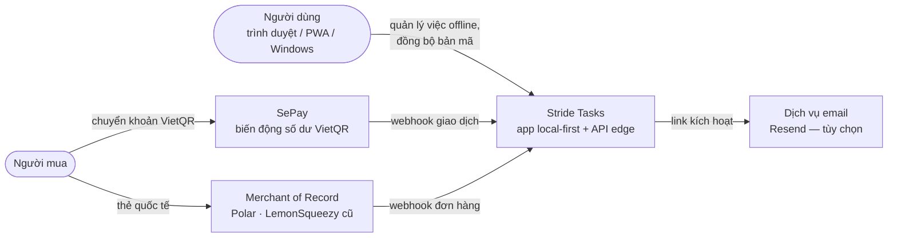
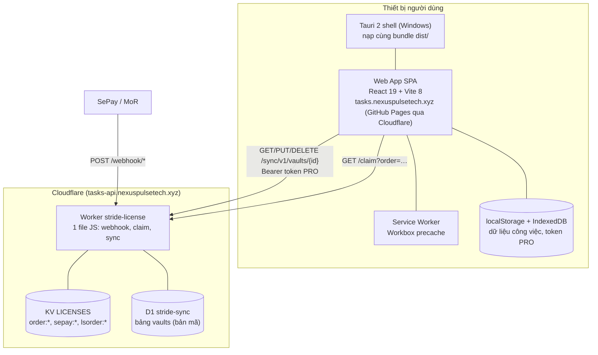
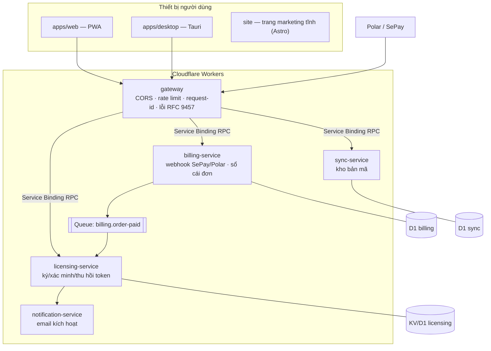

# Sơ đồ hệ thống (mô hình C4)

> **Thuộc**: 04-architecture · **Trạng thái**: Reviewed (hiện tại) / Draft (mục tiêu) · **Cập nhật**: 2026-10-30
> **Chuẩn**: C4 model (Simon Brown) — Level 1 *System Context*, Level 2 *Container*.

## 1. Level 1 — System Context (hiện tại)

## 2. Level 2 — Container (hiện tại, v3.1.0)

**Đặc điểm**: toàn bộ logic nghiệp vụ người dùng chạy trên client; server **không đọc được** dữ liệu công việc (chỉ bản mã AES-256-GCM). Worker là một khối duy nhất chứa cả bí mật thanh toán lẫn API đồng bộ.

## 3. Level 2 — Container (mục tiêu, Phase D)

Nguyên tắc mục tiêu: **mỗi dịch vụ sở hữu dữ liệu riêng** (database-per-service), chỉ giao tiếp qua hợp đồng có phiên bản (HTTP OpenAPI công khai, RPC nội bộ, sự kiện). Khóa bí mật Ed25519 chỉ nằm trong `licensing-service` → bề mặt tấn công của API đồng bộ không chạm tới khóa ký. Chi tiết: [04-backend-services-cloudflare.md](./04-backend-services-cloudflare.md).
