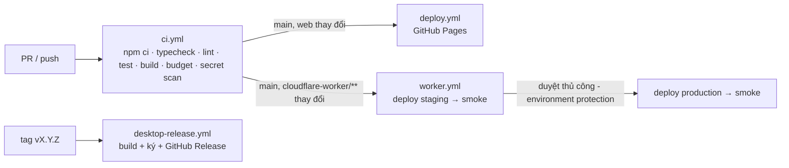

# CI/CD & môi trường

> **Thuộc**: 07-engineering · **Trạng thái**: Reviewed (hiện tại) / Draft (mục tiêu) · **Cập nhật**: 2026-10-30

## 1. Hiện trạng

| Workflow | Kích hoạt | Nội dung | Vấn đề |
| :--- | :--- | :--- | :--- |
| `deploy.yml` | push `main` | checkout@v7, setup-node@v7 (Node 22), `npm install --legacy-peer-deps`, `npm run lint` (tsc), build, Pages (configure@v6, upload-artifact@v5, deploy@v5) | Không test; `npm install` thay vì `npm ci`; không kiểm ngân sách bundle |
| `desktop-release.yml` | tag `v*` | Windows: actions@v4, Rust stable, build web, `setup-bun@v2` với **`bun-version: latest`**, `tauri-action@v0`, `includeUpdaterJson: true` | Action cũ (cảnh báo Node 20); bun không ghim; **chưa ký số**; updater JSON nhưng app chưa có plugin updater; release cuối là v2.1.0 với file tên 1.0.6 |
| Worker | - | **Deploy tay** bằng `wrangler@4.151.0` | Không test, không staging, phụ thuộc máy founder |

## 2. Pipeline mục tiêu

### `ci.yml` (task B03)

1. `actions/checkout`, `actions/setup-node` (Node theo `.nvmrc`, cache npm).
2. `npm ci --legacy-peer-deps`.
3. `npm run typecheck` · `npm run lint` · `npm test -- --coverage`.
4. `npm run build` + script kiểm ngân sách bundle ([05-performance-budgets.md](./05-performance-budgets.md)).
5. Quét bí mật trong diff/bundle (mảnh public của định dạng khóa PKCS8 Ed25519, chuỗi `PRIVATE KEY`).
6. Lint OpenAPI (`@redocly/cli` ghim phiên bản).

### `worker.yml` (task B07)

- Dùng `cloudflare/wrangler-action` (ghim phiên bản) với `CLOUDFLARE_API_TOKEN` quyền tối thiểu + `CLOUDFLARE_ACCOUNT_ID`.
- `wrangler deploy --env staging` → smoke test staging → **GitHub Environment `production` yêu cầu duyệt** → `wrangler deploy --env production` → smoke test production.
- Migration D1: `wrangler d1 migrations apply --env <env> --remote` trước deploy code.

## 3. Môi trường

| Môi trường | Web | API | Dữ liệu | Secret |
| :--- | :--- | :--- | :--- | :--- |
| `local` | `npm run dev` (port 3000) | `wrangler dev --local` | D1/KV cục bộ | `.env.local`, `.dev.vars` (gitignore) |
| `staging` | Preview build (tùy chọn) | Worker `stride-license-staging` (domain staging, cần tạo DNS, **xin phép trước**) | D1/KV staging riêng | Bộ secret staging, MoR ở **chế độ test/sandbox** |
| `production` | `tasks.nexuspulsetech.xyz` | `tasks-api.nexuspulsetech.xyz` | D1 `stride-sync`, KV `LICENSES` | Secret production |

## 4. Chuỗi cung ứng (supply chain)

- `npm ci` + lockfile commit; một lockfile duy nhất (bỏ `bun.lock`).
- **Dependabot** cho `npm` và `github-actions` (hằng tuần, gộp nhóm minor/patch).
- Ghim action theo major đã kiểm tra (tối thiểu), mức cao hơn: ghim theo commit SHA.
- Công cụ chạy bằng `npx` phải ghim phiên bản cụ thể, ưu tiên bản phát hành ≥ 2 tuần (như `wrangler@4.151.0`, `@redocly/cli@2.64.1`).
- Bật **CodeQL** (miễn phí cho repo public) và **secret scanning + push protection**.
- Node: khai báo `.nvmrc` và `engines` để local và CI cùng phiên bản LTS (máy founder đang chạy Node 25, CI chạy Node 22 → lệch).
