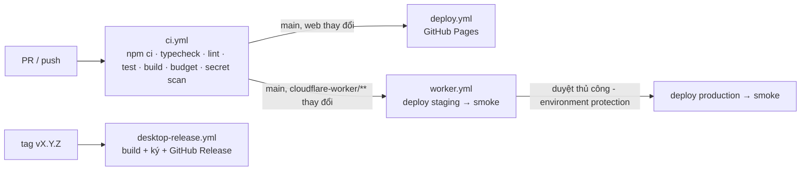

# CI/CD & môi trường

> **Thuộc**: 07-engineering · **Trạng thái**: Reviewed (hiện tại) / Draft (mục tiêu) · **Cập nhật**: 2026-11-19 (B10)

## 1. Hiện trạng

Mọi action ghim theo SHA commit đầy đủ kèm chú thích phiên bản; cấp workflow `permissions: {}`, mỗi job tự khai báo quyền tối thiểu; checkout không giữ token (`persist-credentials: false`). Dependabot nâng action hằng tuần (`.github/dependabot.yml`). Xem [B10](../10-execution-plan/B10-supply-chain-and-signing-key.md).

| Workflow | Kích hoạt | Nội dung | Vấn đề |
| :--- | :--- | :--- | :--- |
| `deploy.yml` | push `main` | checkout v7.0.1, setup-node v7.1.0 (Node 22), `npm ci --legacy-peer-deps`, `npm run lint` (tsc), `npm test`, build, Pages (configure-pages v6.0.0, upload-pages-artifact v5.0.0, deploy-pages v5.0.1); quyền `contents: read`, `pages: write`, `id-token: write` | Chưa có workflow `ci` riêng chặn PR; không kiểm ngân sách bundle (B03) |
| `desktop-release.yml` | chạy tay (`workflow_dispatch`) | Windows: checkout v7.0.1, setup-node v7.1.0, `rust-toolchain` (commit nhánh `stable`, `toolchain: stable`), `npm ci --legacy-peer-deps`, build web, `tauri-action` v0.6.2 với `tauriScript: npx tauri`, `includeUpdaterJson: true`; chỉ job này có `contents: write` | **Chưa ký số**; updater JSON nhưng app chưa có plugin updater; chạy tay từ `main` thì `tagName` lấy `github.ref_name` thành tag `main` (sửa cùng D02); release cuối là v2.1.0 với file tên 1.0.6 |
| `worker-tests.yml` | push/PR chạm `cloudflare-worker/**` | checkout, setup-node, `npm ci`, test Worker (Miniflare); quyền `contents: read` | Không deploy Worker (B07) |
| `health-check.yml` | mỗi 6 giờ, chạy tay | Chỉ `curl` tới production (app, header, trang tĩnh, Worker); không quyền token nào | Lịch tự tắt sau 60 ngày repo không có commit |
| Worker | - | **Deploy tay** bằng `wrangler@4.153.0` | Không test, không staging, phụ thuộc máy founder |

## 2. Pipeline mục tiêu

### `ci.yml` (task B03)

1. `actions/checkout`, `actions/setup-node` (Node theo `.nvmrc`, cache npm).
2. `npm ci --legacy-peer-deps`.
3. `npm run typecheck` · `npm run lint` · `npm test -- --coverage`.
4. `npm run build` + script kiểm ngân sách bundle ([05-performance-budgets.md](./05-performance-budgets.md)).
5. Quét bí mật trong diff/bundle (mảnh public của định dạng khóa PKCS8 Ed25519, chuỗi `PRIVATE KEY`).
6. Lint OpenAPI (`@redocly/cli` ghim phiên bản).

### `worker.yml` (task B07)

- Dùng `cloudflare/wrangler-action` (ghim phiên bản) với `CLOUDFLARE_API_TOKEN` quyền tối thiểu + `CLOUDFLARE_ACCOUNT_ID`.
- `wrangler deploy --env staging` → smoke test staging → **GitHub Environment `production` yêu cầu duyệt** → `wrangler deploy --env production` → smoke test production.
- Migration D1: `wrangler d1 migrations apply --env <env> --remote` trước deploy code.

## 3. Môi trường

| Môi trường | Web | API | Dữ liệu | Secret |
| :--- | :--- | :--- | :--- | :--- |
| `local` | `npm run dev` (port 3000) | `wrangler dev --local` | D1/KV cục bộ | `.env.local`, `.dev.vars` (gitignore) |
| `staging` | Preview build (tùy chọn) | Worker `stride-license-staging` (domain staging, cần tạo DNS, **xin phép trước**) | D1/KV staging riêng | Bộ secret staging, MoR ở **chế độ test/sandbox** |
| `production` | `tasks.nexuspulsetech.xyz` | `tasks-api.nexuspulsetech.xyz` | D1 `stride-sync`, KV `LICENSES` | Secret production |

## 4. Chuỗi cung ứng (supply chain)

- `npm ci` + lockfile commit; một lockfile duy nhất. **Đã làm ở B10** (bỏ `bun.lock` thừa từ mẫu ban đầu).
- **Dependabot** cho `github-actions`: **đã làm ở B10** (hằng tuần, gộp một nhóm, `cooldown` 7 ngày). Hệ `npm` còn lại cho B03.
- Ghim action theo commit SHA đầy đủ: **đã làm ở B10**. Founder bật thêm yêu cầu ghim SHA ở cài đặt repo (`sha_pinning_required`) sau khi B10 lên `main`. Đánh đổi: Dependabot không báo lỗ hổng cho action ghim SHA, nên lịch nâng hằng tuần là thứ giữ action luôn mới.
- Phụ thuộc chỉ dùng lúc build (`vite`, plugin Vite, Tailwind) nằm ở `devDependencies` (B10); `npm audit --omit=dev` phải luôn 0.
- Công cụ chạy bằng `npx` phải ghim phiên bản cụ thể, ưu tiên bản phát hành ≥ 2 tuần (như `wrangler@4.153.0`, `@redocly/cli@2.64.1`).
- Bật **CodeQL** (miễn phí cho repo public) và **secret scanning + push protection**.
- Node: khai báo `.nvmrc` và `engines` để local và CI cùng phiên bản LTS (máy founder đang chạy Node 25, CI chạy Node 22 → lệch).
