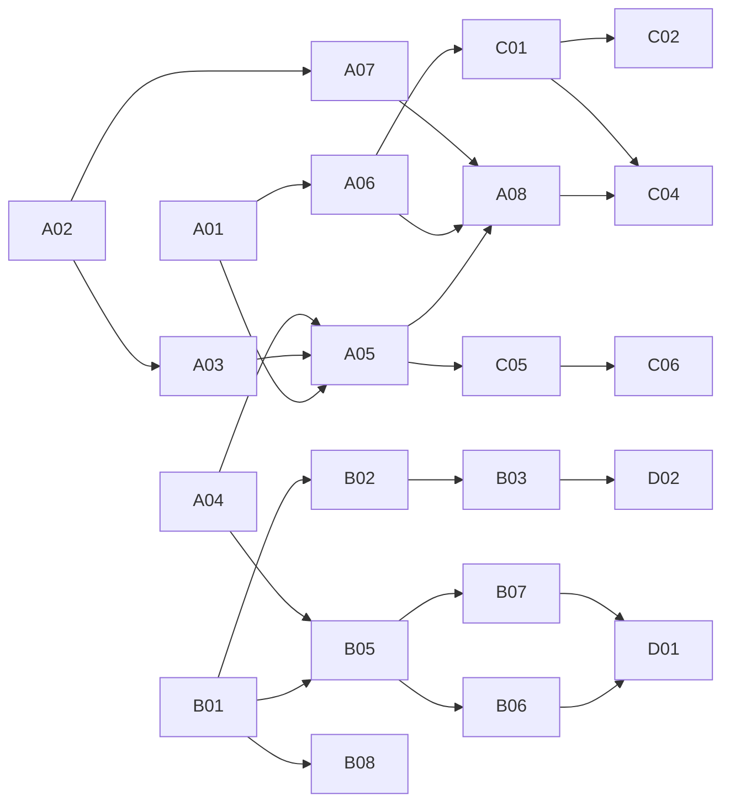

# 10: Kế hoạch thực thi (Execution Plan)

> **Thuộc**: 10-execution-plan · **Trạng thái**: Active · **Cập nhật**: 2026-10-30
> **Mục tiêu số 1**: **khách hàng trả tiền đầu tiên**. Phase A là đường găng (critical path); Phase B chạy song song nhưng **không được chặn** Phase A.
> **Quy tắc**: mỗi file = **một** nhiệm vụ có tiêu chí nghiệm thu. Làm xong task nào → cập nhật cột *Trạng thái* trong bảng dưới **trong cùng PR**.

## 1. Bốn phase và điều kiện hoàn thành

| Phase | Tên | Điều kiện hoàn thành (exit criteria) |
| :--- | :--- | :--- |
| **A** | First Dollar | Có ≥ 1 đơn thật thành công qua kênh tự động; khách nhận PRO ≤ 60 giây; hoàn tiền thử thành công |
| **B** | Foundation | CI chặn PR khi test/lint/type/budget lỗi; Worker TypeScript có test; hợp đồng dùng chung; không file > 300 dòng mới |
| **C** | Growth engine | Site marketing EN/VI đầy đủ; ≥ 8 bài nội dung; có mặt trên Microsoft Store; launch PH/HN xong |
| **D** | Scale | Dịch vụ tách theo ADR-0005 khi đủ điều kiện; desktop ký số + auto-update; quyết định giá/giấy phép |

## 2. Bảng trạng thái

Ký hiệu: ☐ Todo · ◐ In progress · ☑ Done · ⏸ Blocked (ghi lý do)

| ID | Nhiệm vụ | Ưu tiên | Ước lượng | Phụ thuộc | Trạng thái |
| :--- | :--- | :---: | :---: | :--- | :---: |
| [A01](./A01-brand-and-seo-metadata-fix.md) | Sửa thương hiệu & SEO metadata | P0 | 0,5 ngày | - | ☑ 2026-10-30 |
| [A02](./A02-legal-pages-terms-refund.md) | Trang Điều khoản, Hoàn tiền, cập nhật Quyền riêng tư | P0 | 0,5 ngày | - | ☑ 2026-10-30 |
| [A03](./A03-merchant-of-record-onboarding.md) | Đăng ký & cấu hình Merchant of Record (Polar) | P0 | 1-3 ngày (chờ duyệt) | A02 | ◐ |
| [A04](./A04-checkout-webhook-and-claim-hardening.md) | Đơn hàng, webhook Polar, claim an toàn, hoàn tiền → thu hồi, backoff | P0 | 2 ngày | - | ◐ A04a + A04b (code webhook Polar) xong 2026-10-30; chờ founder tạo sản phẩm, Checkout Link, webhook trong Polar để thử sandbox |
| [A05](./A05-enable-payments-in-production.md) | Bật thanh toán production (secret, SePay, biến, mua thử) | P0 | 0,5 ngày | A01-A04 | ☐ |
| [A06](./A06-landing-and-pricing-pages.md) | Trang đích + bảng giá EN/VI (HTML tĩnh; Astro chuyển sang C01) | P0 | 1,5 ngày | A01 | ☑ 2026-10-30 (Lighthouse 100/100/100) |
| [A07](./A07-privacy-friendly-analytics.md) | Đo lường không xâm phạm riêng tư | P0 | 0,5 ngày | A02 | ☑ 2026-10-30 (Web Analytics; sitemap gửi lại, yêu cầu lập chỉ mục `/`, `/en/`, `/vi/`) |
| [A08](./A08-first-customer-outreach-sprint.md) | Sprint outreach quốc tế 14 ngày (ADR-0009) | P0 | 14 ngày | A05-A07 | ☐ |
| [A09](./A09-allow-ai-crawlers.md) | Mở bot AI tìm kiếm/trợ lý trên Cloudflare (ADR-0010) | P0 | 0,2 ngày | founder đăng nhập Cloudflare | ☑ |
| [A10](./A10-bing-webmaster-and-indexnow.md) | Bing Webmaster Tools + IndexNow | P1 | 0,2 ngày | founder đăng nhập Bing | ☑ |
| [B01](./B01-test-suite-in-repo.md) | Bộ test trong repo (Vitest, Worker, E2E khung) | P1 | 2 ngày | - | ◐ |
| [B02](./B02-lint-format-strict-typescript.md) | ESLint, Prettier, TS strict, dọn phụ thuộc | P1 | 2-3 ngày | B01 | ☐ |
| [B03](./B03-ci-quality-gates.md) | CI quality gates + chuỗi cung ứng | P1 | 1 ngày | B01, B02 | ☐ |
| [B04](./B04-error-boundary-and-csp.md) | Error Boundary + CSP web/Tauri | P1 | 1 ngày | - | ☐ |
| [B05](./B05-worker-typescript-hexagonal.md) | Worker TypeScript + kiến trúc lục giác + timeout client | P1 | 3 ngày | B01, A04 | ☐ |
| [B06](./B06-shared-contracts-package.md) | Gói `contracts` + `sync-core` dùng chung (npm workspaces) | P1 | 2 ngày | B05 | ☐ |
| [B07](./B07-worker-cicd-staging-observability.md) | CI/CD Worker, staging, log, rate limit | P1 | 1,5 ngày | B05 | ☐ |
| [B08](./B08-split-oversized-modules.md) | Tách 29 file > 300 dòng (từng PR) | P2 | liên tục | B01, B02 | ☐ |
| [C01](./C01-marketing-site-ssg-i18n.md) | Site marketing đầy đủ (tính năng, so sánh, blog) | P1 | 3 ngày | A06 | ☐ |
| [C02](./C02-content-pillars-and-comparison-pages.md) | Trụ cột nội dung & trang so sánh (8 tuần) | P1 | liên tục | C01 | ☐ |
| [C03](./C03-localization-wave-1.md) | Bản địa hóa đợt 1 | P2 | 3-5 ngày | A07 (dữ liệu) | ☐ |
| [C04](./C04-launch-product-hunt-show-hn.md) | Launch Product Hunt & Show HN | P1 | 1 tuần chuẩn bị | A08, C01 | ☐ |
| [C05](./C05-microsoft-store-submission.md) | Microsoft Store (PWA → MSIX) | P1 | 1-2 ngày + duyệt | A05 | ☐ |
| [C06](./C06-google-play-twa-and-billing.md) | Google Play TWA + Play Billing | P2 | 1-2 tuần | C05, B05 | ☐ |
| [C07](./C07-directories-and-listicle-outreach.md) | Thư mục phần mềm + xin vào bài tổng hợp (EN) | P1 | liên tục | A06 | ◐ |
| [D01](./D01-service-split-and-monorepo.md) | Tách dịch vụ + monorepo | P2 | 1-2 tuần | B06, B07 | ☐ |
| [D02](./D02-desktop-release-pipeline.md) | Pipeline desktop: ký số, auto-update, đồng bộ phiên bản | P2 | 2-3 ngày | B03 | ☐ |
| [D03](./D03-apple-platforms-evaluation.md) | Đánh giá iOS/macOS | P3 | 0,5 ngày | doanh thu | ☐ |
| [D04](./D04-pricing-evolution-subscription.md) | Tiến hóa mô hình giá | P3 | 1 ngày | ≥ 50 đơn | ☐ |
| [D05](./D05-source-license-decision.md) | Quyết định giấy phép mã nguồn | P2 | 0,5 ngày | founder | ☐ |

## 3. Đồ thị phụ thuộc

## 4. Quyết định cần founder (chặn một số task)

| # | Quyết định | Ảnh hưởng task |
| :---: | :--- | :--- |
| 1 | Duyệt ADR-0005 (modular monolith), ADR-0006 (Polar), ADR-0007 (site tĩnh cùng origin) | A03, A04, A06, D01 |
| 2 | Chọn giấy phép mã nguồn (ADR-0008) | D05 |
| 3 | Tự tạo tài khoản & KYC: **Polar** (payout Stripe Connect), **SePay**, Microsoft Partner Center, (sau) Google Play Console, *AI không thể tạo tài khoản/nhập giấy tờ thay bạn* | A03, A05, C05, C06 |
| 4 | Thông tin nhận tiền VietQR (ngân hàng, số tài khoản, tên) | A05 |
| 5 | Cho phép tạo bản ghi DNS staging, token API Cloudflare cho CI, bật branch protection/secret scanning trên GitHub | B03, B07 |
| 6 | Mức ưu đãi Founding Member (đề xuất −30%, 100 suất) | A03, A06 |

## 5. Cách làm một task (cho người & AI agent)

1. Đọc file task + các tài liệu ở mục *Tham chiếu*.
2. Đổi trạng thái → ◐ trong bảng trên.
3. Làm trên nhánh riêng; một task = một PR (task lớn chia nhiều PR, ghi rõ trong file task).
4. Đạt **toàn bộ** *Tiêu chí nghiệm thu* + Definition of Done ở [../07-engineering/README.md](../07-engineering/README.md).
5. Cập nhật tài liệu bị ảnh hưởng (OpenAPI, ADR, readiness audit) → trạng thái ☑.
6. Mẫu cho task mới: [_template.md](./_template.md).
